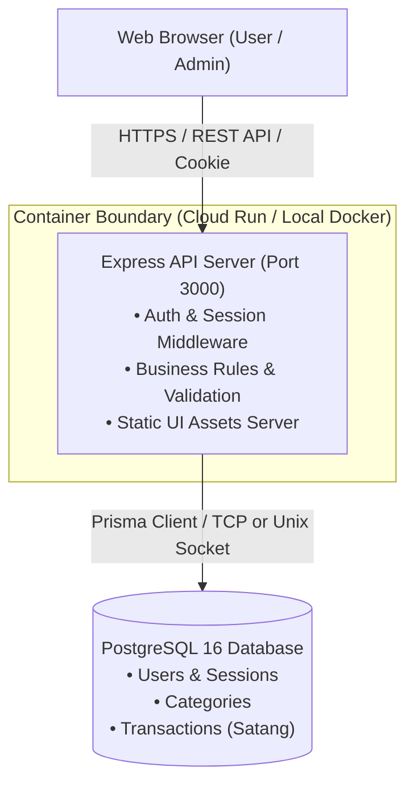
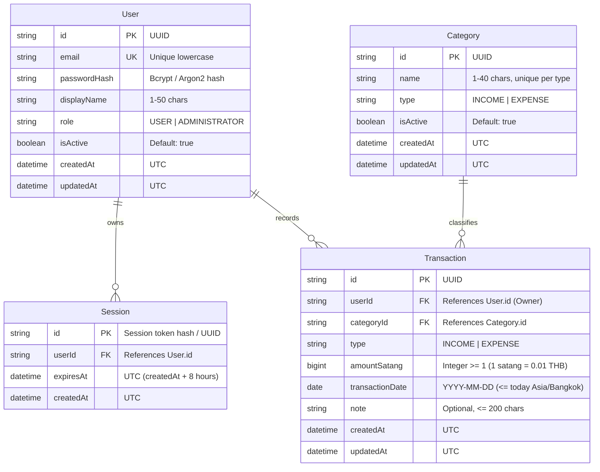

# System-Level Software Design Specification (SDS): Pocket48

Version 0.1 (DRAFT for team review). Project: Pocket48. Theme: Personal Money and Expense Logging System (User / Administrator).

---

## 1. Architecture and Component Responsibilities

### 1.1 Architecture Overview
Pocket48 follows a classic three-tier architecture:
1. **Frontend (Presentation Tier):** Single-Page Application (SPA) built with React 18, TypeScript, and Vite.
2. **Backend API (Application Tier):** RESTful HTTP API built with Node.js, Express, and TypeScript. Enforces all authentication, authorization, business rules, and validation.
3. **Database (Data Tier):** PostgreSQL managed relational database, accessed via Prisma ORM with strictly typed migrations.



### 1.2 Component Responsibilities
* **UI (React + Vite):**
  * Renders screens, forms, tables, and feedback messages.
  * Performs client-side UX pre-validation (instant feedback for empty fields or negative numbers).
  * Stores **no** security credentials in `localStorage` or memory; relies solely on HTTP-only session cookies.
  * Communicates with the API using JSON payloads over `fetch`/`axios` relative paths (`/api/...`).
* **API Server (Express + TypeScript):**
  * **Authentication & Session:** Validates credentials, sets/clears HTTP-only cookies, resolves `req.user` and `req.session` from PostgreSQL session records.
  * **Authorization & Ownership:** Enforces role-based permissions (User vs Administrator) and record-level ownership isolation (User A cannot access User B's records).
  * **Domain Validation & Rules:** Strictly enforces BR-01 (satang conversion and bounds), BR-02 (category type match & active status), BR-03 (no future dates), and BR-05 (unique category names).
  * Serves the compiled production React static bundle when running in single-container mode.
* **Database (PostgreSQL + Prisma):**
  * Persists user accounts, hashed passwords, active sessions, category catalogs, and financial transaction records.
  * Guarantees ACID compliance, foreign key integrity, and unique constraints.

---

## 2. Data Model and Schema Specification

### 2.1 Entity Relationship Diagram (ERD)



### 2.2 Data Entities and Satang Representation (D-03)
* **Amount Storage:** To prevent IEEE 754 floating-point rounding errors (NFR-07), monetary values are stored in the database as integer satang (`amountSatang` of type `BigInt` or `Int`).
  $$\text{amountSatang} = \text{round}(\text{amountInTHB} \times 100)$$
  * Example: 120.50 THB is stored as `12050`. 0.01 THB is stored as `1`.
  * The API accepts either a decimal number with at most 2 decimal places or converts it safely using integer arithmetic.
* **Date Handling (A-01, BR-03):** `transactionDate` represents the calendar date of the transaction. The server checks that this date is not strictly greater than the current date in timezone `Asia/Bangkok`.

### 2.3 Prisma Schema Definition
```prisma
datasource db {
  provider = "postgresql"
  url      = env("DATABASE_URL")
}

generator client {
  provider = "prisma-client-js"
}

enum Role {
  USER
  ADMINISTRATOR
}

enum TransactionType {
  INCOME
  EXPENSE
}

model User {
  id           String        @id @default(uuid())
  email        String        @unique
  passwordHash String
  displayName  String
  role         Role          @default(USER)
  isActive     Boolean       @default(true)
  createdAt    DateTime      @default(now())
  updatedAt    DateTime      @updatedAt

  sessions     Session[]
  transactions Transaction[]

  @@map("users")
}

model Session {
  id        String   @id @default(uuid())
  userId    String
  user      User     @relation(fields: [userId], references: [id], onDelete: Cascade)
  expiresAt DateTime
  createdAt DateTime @default(now())

  @@index([expiresAt])
  @@map("sessions")
}

model Category {
  id           String          @id @default(uuid())
  name         String
  type         TransactionType
  isActive     Boolean         @default(true)
  createdAt    DateTime        @default(now())
  updatedAt    DateTime        @updatedAt

  transactions Transaction[]

  @@unique([name, type])
  @@map("categories")
}

model Transaction {
  id              String          @id @default(uuid())
  userId          String
  user            User            @relation(fields: [userId], references: [id], onDelete: Cascade)
  categoryId      String
  category        Category        @relation(fields: [categoryId], references: [id], onDelete: Restrict)
  type            TransactionType
  amountSatang    Int             // 1 to 999,999,999 satang (up to 9,999,999.99 THB)
  transactionDate DateTime        @db.Date
  note            String?         @db.VarChar(200)
  createdAt       DateTime        @default(now())
  updatedAt       DateTime        @updatedAt

  @@index([userId, transactionDate(sort: Desc)])
  @@map("transactions")
}
```

### 2.4 Database Migrations & Reproducible Seed Data
* **Migrations:** Managed through `npx prisma migrate deploy` in production / CI and `npx prisma migrate dev` in local development.
* **Seed Data (`prisma/seed.ts`):**
  * Creates initial System Categories (e.g. Income: "Salary", "Bonus"; Expense: "Food", "Transport", "Utilities").
  * Seeds demo accounts:
    * Administrator: `admin@pocket48.local` (Password from `ADMIN_PASSWORD` env var, fallback for local dev).
    * User 1: `user1@pocket48.local` (Password from `DEMO_USER_PASSWORD` env var).
    * User 2: `user2@pocket48.local` (For ownership isolation testing).
  * Safe to re-run idempotently using `upsert`.

---

## 3. UI, API, and Access Conventions

### 3.1 Main Screens & Shared UI Behavior
* **Screens:**
  1. **Login Screen (`/login`):** Email and password input, accessible to anonymous users.
  2. **My Transactions (`/transactions`):** Main User screen showing the user's recorded transactions, total balance, and a button to open the "Record Transaction" modal/drawer.
  3. **Record Transaction Form (`/transactions/new`):** Inputs for Type, Category (dropdown filtered by type), Amount, Date, and Note.
  4. **Category Catalogue (`/admin/categories`):** Administrator screen for listing and creating system categories.
* **Shared UI States:**
  * **Loading State:** Skeletons or spinners during network requests.
  * **Empty State:** Friendly guidance (e.g., "No transactions yet. Click 'Record Transaction' to start.").
  * **Error State:** In-line field validation errors and prominent toast alerts for network/server errors.

### 3.2 API Conventions & Request/Response Shape
All API routes are prefixed with `/api`.
* **Standard Success Response:**
  ```json
  {
    "data": { ... }
  }
  ```
* **Standard Error Response:**
  ```json
  {
    "error": {
      "code": "VALIDATION_ERROR",
      "message": "Transaction amount must be greater than 0."
    }
  }
  ```
* **HTTP Status Code Mapping:**
  * `200 OK`: Successful retrieval / update.
  * `201 Created`: Successful creation.
  * `400 Bad Request`: Validation failure (BR-01, BR-02, BR-03, BR-05).
  * `401 Unauthorized`: Missing, invalid, or expired session (NFR-01).
  * `403 Forbidden`: Authenticated user lacks required role (BR-10, BR-07).
  * `404 Not Found`: Entity not found **OR** requested transaction belongs to another user (BR-04, D-04).
  * `503 Service Unavailable`: Database unreachable (`/api/ready`).

### 3.3 Role and Permission Matrix

| Operation / Endpoint | Anonymous | User | Administrator | Note / Rule |
|---|:---:|:---:|:---:|---|
| `GET /api/health` |  |  |  | Liveness probe |
| `GET /api/ready` |  |  |  | Database readiness probe (Smoke test) |
| `POST /api/auth/login` |  |  |  | Rejects with generic error (FR-01) |
| `POST /api/auth/logout` | ❌ 401 |  |  | Invalidates session (FR-02) |
| `GET /api/auth/me` | ❌ 401 |  |  | Current user details & role (FR-03) |
| `GET /api/categories` | ❌ 401 |  |  | Lists active categories (FR-07) |
| `POST /api/categories` | ❌ 401 | ❌ 403 |  | Admin only (FR-06, BR-10) |
| `POST /api/transactions` | ❌ 401 |  | ❌ 403 | User only (FR-04, BR-07) |
| `GET /api/transactions` | ❌ 401 |  (Own only) | ❌ 403 | Admin cannot view (BR-04, BR-07) |
| `GET /api/transactions/:id` | ❌ 401 |  (Own only) | ❌ 403 | Returns 404 if owned by another user (BR-04, D-04) |

### 3.4 Authentication & Session Design
* **Password Security (NFR-02):** Stored using salted hashing (`bcrypt` with cost factor 10 or `argon2id`). Passwords and hashes are omitted from all Prisma query returns.
* **Session Storage (NFR-03):** Stored in PostgreSQL `sessions` table. A secure `pocket48_session` cookie is issued to the browser:
  * `HttpOnly: true` (prevents XSS theft)
  * `Secure: true` in production (HTTPS only)
  * `SameSite: "lax"` (CSRF defense)
  * `Max-Age: 28800` (8 hours)
* **Logout & Expiry:** On logout (`POST /api/auth/logout`), the session row is deleted from the database and the cookie is cleared. Expired sessions are rejected automatically by the auth middleware.

---

## 4. Configuration and Delivery Design

### 4.1 Environment Variables
All configuration is read from the runtime environment. No secrets or connection strings are hardcoded.

| Variable Name | Purpose | Secret? | Source (Local / Cloud) |
|---|---|:---:|---|
| `PORT` | HTTP port server listens on | No | `3000` locally, assigned by Cloud Run in production |
| `NODE_ENV` | Application mode (`development` / `production`) | No | Local `.env` / Cloud Run env var |
| `DATABASE_URL` | PostgreSQL connection string | **Yes** | Docker compose URL locally / GCP Secret Manager in Cloud |
| `SESSION_SECRET` | Key used to sign session cookies | **Yes** | Local `.env` / GCP Secret Manager in Cloud |
| `ADMIN_PASSWORD` | Password for seeded Admin account | **Yes** | Local `.env` / GCP Secret Manager in Cloud |
| `DEMO_USER_PASSWORD` | Password for seeded User accounts | **Yes** | Local `.env` / GCP Secret Manager in Cloud |

### 4.2 Planned GCP Deployment Components (Lab 5 Alignment)
* **Cloud Run:** Runs the single container image (`pocket48`) hosting both static UI and Express API on port 3000. Scales to zero when idle to conserve credits.
* **Cloud SQL (PostgreSQL 16):** Fully managed database with dedicated private/public IP connection and automated backups. Storage auto-increase is explicitly disabled to cap costs.
* **Artifact Registry:** Stores versioned container images tagged with full git commit SHAs.
* **Secret Manager:** Safely injects `DATABASE_URL`, `ADMIN_PASSWORD`, and `SESSION_SECRET` directly into Cloud Run container environment without storing them in Git or pipeline configs.
* **GitHub Actions with Workload Identity Federation (WIF):** Authenticates the deployment pipeline to GCP without any long-lived JSON service account keys.

